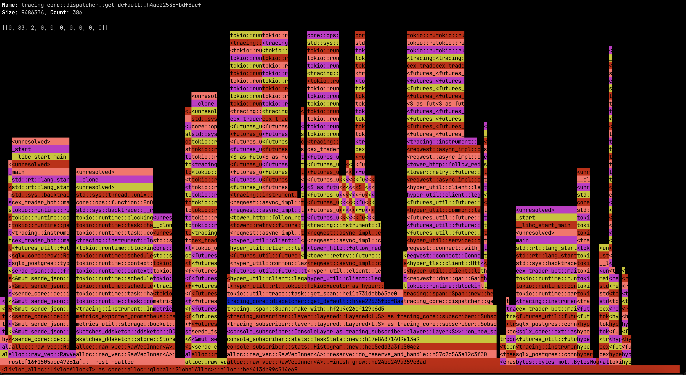

# Livloc

Allocator utilities to view live Rust allocations

## Usage

To use Livloc allocator you should first set it as global allocator and start server. (Install with `server` feature enabled)

```rust
use std::alloc::System;

use livloc_alloc::LivlocAlloc;

#[global_allocator]
static ALLOC: LivlocAlloc<System> = LivlocAlloc::new(System);

#[tokio::main]
async fn main() -> Result<(), Box<dyn std::error::Error>> {
    let serve = ALLOC.serve("127.0.0.1:3000").await?;
    let _handle = tokio::spawn(serve.into_future());

    // ... your application code here
}
```

This will start a server on `http://127.0.0.1:3000` which can be viewed with `livloc-cli`.

## Cli



You can navigate using keyboard arrows as well as with a mouse.
To zoom in you you press enter and to zoom out you press space.

## License

This project is licensed under the **GNU General Public License v3.0 (GPL-3.0)**.

You are free to use, study, clone, fork, modify, and redistribute this project under the terms of the GPL v3.

If you distribute modified versions of this software, you must comply with the GPL v3, including its applicable source code and licensing requirements.

See the [LICENSE](LICENSE) file for the full license text.
